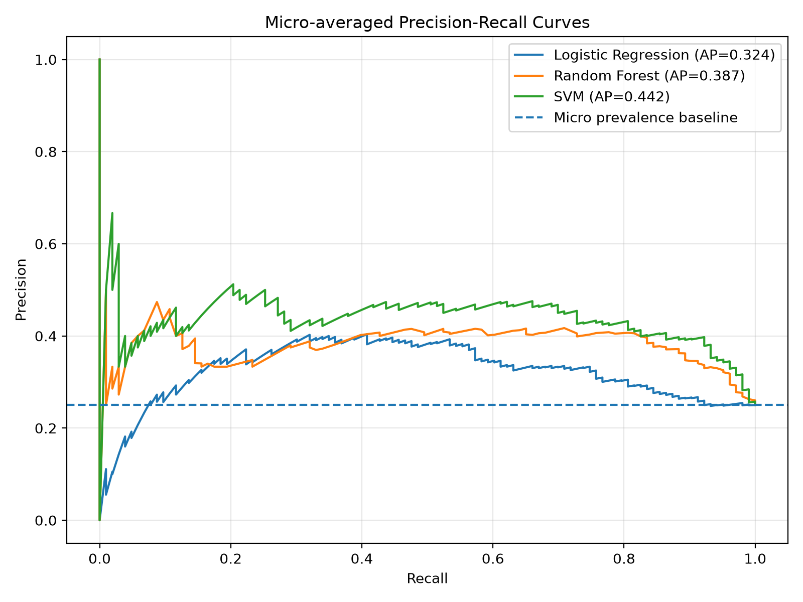
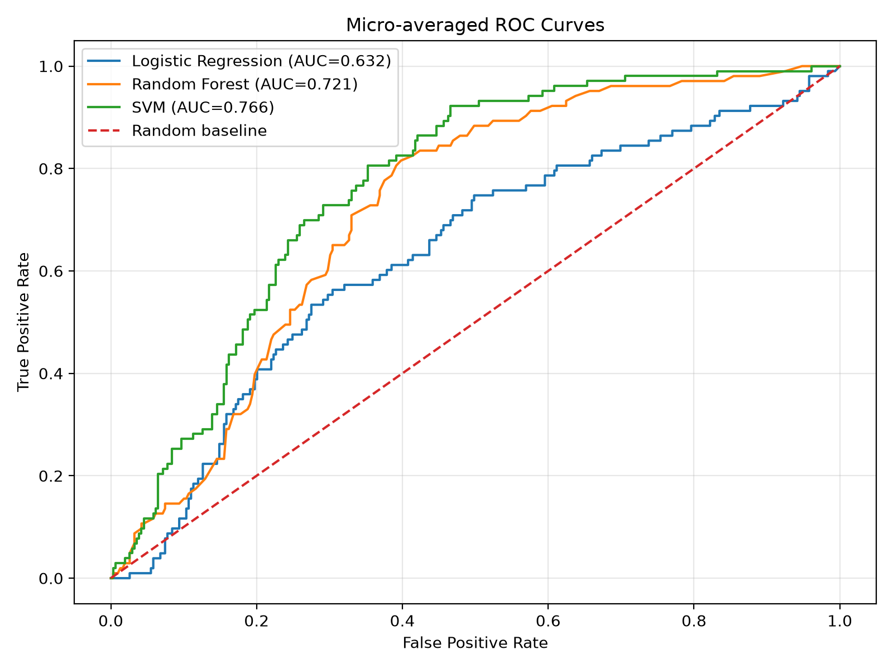
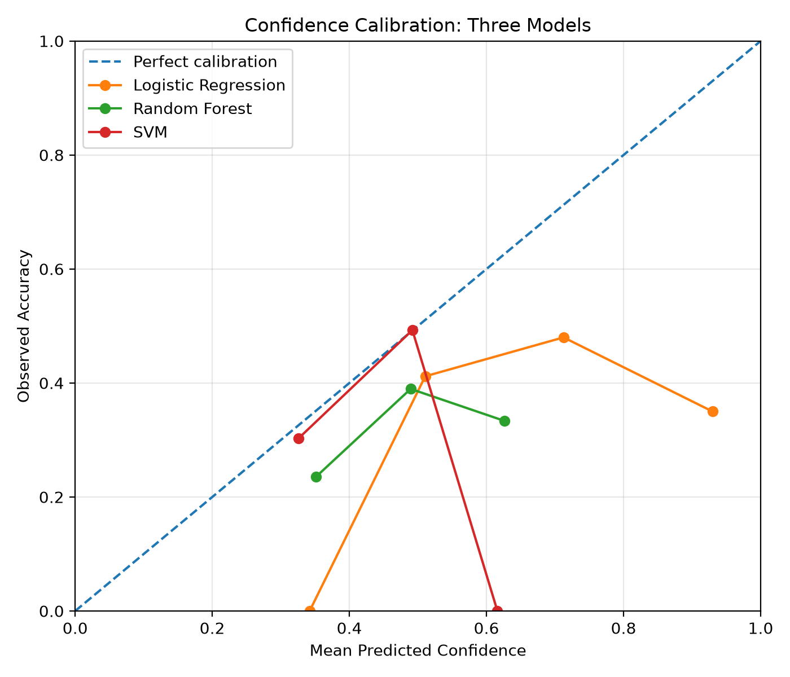
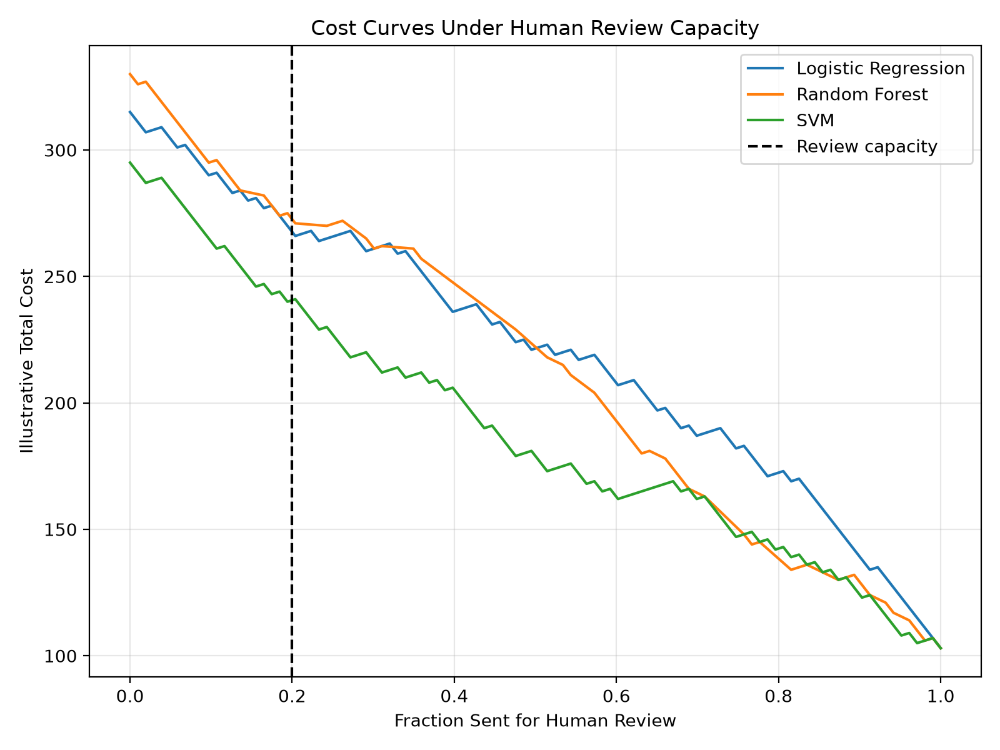

# DS-A4: Model Comparison and Calibration Lab

## 1. Frozen Evaluation Protocol

The analysis used Table S2 from the supplementary workbook of Ali et al. (2025), *Journal of Asian Earth Sciences* (DOI: 10.1016/j.jseaes.2025.106927).

The dataset contains 103 in-situ geochemical observations, 60 candidate predictors, and four classification categories: Oolite core, Oolite Rim, Pellet Core, and Pellet Rim.

A five-fold Stratified Group Cross-Validation protocol was established using random seed 42. The grouping variable combined stratigraphic unit and analytical point identifier, producing 62 analytical groups.

**Table 1. Frozen evaluation fold distribution.**

| Fold | Observations |
|---|---:|
| 1 | 20 |
| 2 | 21 |
| 3 | 20 |
| 4 | 20 |
| 5 | 22 |
| **Total** | **103** |

Group-separation verification confirmed zero overlapping groups between training and testing in all five folds.

The same frozen folds, predictors, and evaluation metrics were used for Logistic Regression, Random Forest, and Support Vector Machine (SVM). All three models used fixed configurations without hyperparameter search, providing an equal tuning-search budget of zero trials. Their computational costs were not controlled to be identical.

Preprocessing was fitted only on training observations within each fold.

## 2. Paired Model Comparison

The three models were evaluated using their out-of-fold predictions.

**Table 2. Model performance comparison.**

| Model | Accuracy | Macro-F1 | Log loss |
|---|---:|---:|---:|
| Logistic Regression | 0.3884 | 0.3549 | 3.1934 |
| Random Forest | 0.3592 | 0.3476 | 1.1930 |
| SVM | 0.3884 | 0.3282 | 1.1074 |

Logistic Regression and SVM achieved equal accuracy (38.84%). Logistic Regression produced the highest macro-F1 score (0.3549), while SVM achieved the lowest log loss (1.1074).

Random Forest did not improve classification accuracy over the simple baseline.

These findings show that model complexity did not consistently improve hard-classification performance. However, the models differed substantially in the quality of their predicted probabilities.

The complete observation-level paired predictions and fold-level statistics are retained in `results/paired_model_predictions.csv` and `results/paired_fold_accuracy.csv`.

## 3. Precision–Recall and ROC Evaluation

For the four-class classification task, one-vs-rest Precision–Recall and ROC analyses were performed using the saved out-of-fold probabilities.

**Table 3. Micro-averaged discrimination metrics.**

| Model | PR-AP | ROC-AUC |
|---|---:|---:|
| Logistic Regression | 0.3242 | 0.6318 |
| Random Forest | 0.3868 | 0.7207 |
| SVM | 0.4421 | 0.7660 |

SVM achieved the highest PR-AP (0.4421) and ROC-AUC (0.7660), indicating stronger overall probability-based discrimination than the other models in this evaluation.

*Figure 1. Micro-averaged Precision–Recall curves for the three models.*

*Figure 2. Micro-averaged ROC curves for the three models.*

The curves support SVM's comparatively stronger ranking performance. Nevertheless, the PR-AP values indicate that discrimination remains limited, and strong performance is not uniform across all mineral phases.

## 4. Probability Calibration: Brier Score and ECE

Probability quality was evaluated using the multiclass Brier score and top-label Expected Calibration Error (ECE), with five fixed equal-width confidence bins.

**Table 4. Probability calibration results.**

| Model | Multiclass Brier | Top-label ECE |
|---|---:|---:|
| Logistic Regression | 0.9939 | 0.4138 |
| Random Forest | 0.6756 | 0.1194 |
| SVM | 0.6327 | 0.0139 |

SVM achieved the lowest Brier score and ECE, followed by Random Forest.

Logistic Regression exhibited substantial overconfidence. In its highest-confidence bin, 60 predictions had a mean confidence of approximately 0.9298, while observed accuracy was only 0.3500.

*Figure 3. Top-label confidence calibration curves. The diagonal represents perfect calibration.*

Although SVM obtained the lowest ECE, calibration estimates remain sensitive to binning and sample size.

An additional consistency check revealed that SVM hard class predictions differed from its highest-probability class for 48 of the 103 observations. Consequently, the hard-classification scores and probability-based decision analysis represent different prediction rules and should not be treated as directly interchangeable.

## 5. Uncertainty Intervals and Paired Statistics

Uncertainty was estimated using 1,000 paired group-level bootstrap resamples with random seed 42. Entire `Group_ID` units were resampled, preserving dependence among related observations.

**Table 5. Accuracy and 95% bootstrap confidence intervals.**

| Model | Accuracy | 95% CI |
|---|---:|---|
| Logistic Regression | 0.3884 | 0.2889–0.4836 |
| Random Forest | 0.3592 | 0.2653–0.4536 |
| SVM | 0.3884 | 0.2979–0.4796 |

**Table 6. Paired differences in accuracy.**

| Comparison | Difference | 95% CI |
|---|---:|---|
| Logistic Regression − Random Forest | 0.0291 | −0.0878 to 0.1416 |
| Logistic Regression − SVM | 0.0000 | −0.1031 to 0.1064 |
| Random Forest − SVM | −0.0291 | −0.1143 to 0.0637 |

All three paired accuracy intervals include zero, indicating that the analysis does not clearly distinguish the models in terms of accuracy.

For probability quality, Logistic Regression had a substantially higher Brier score than SVM. Their paired Brier difference was 0.3612, with a 95% interval of 0.2301–0.4928.

However, the Random Forest–SVM Brier difference was 0.0428, with an interval of −0.0052 to 0.1001, which includes zero.

The bootstrap intervals quantify variation in the existing out-of-fold results. They do not capture additional uncertainty from retraining the models on new datasets.

## 6. Critical Error Slices and Failure Types

Classification errors were examined across mineral-phase classes, stratigraphic units, and missingness categories.

### 6.1 Mineral-phase error analysis

**Table 7. Classification error rate by mineral phase.**

| Mineral phase | Logistic Regression | Random Forest | SVM |
|---|---:|---:|---:|
| Oolite core | 0.600 | 0.571 | 0.314 |
| Oolite Rim | 0.333 | 0.630 | 0.630 |
| Pellet Core | 0.800 | 0.700 | 0.850 |
| Pellet Rim | 0.810 | 0.714 | 0.857 |

Logistic Regression performed comparatively well for Oolite Rim but showed high error rates for pellet components.

SVM performed best for Oolite core, while its error rates exceeded 85% for both Pellet Core and Pellet Rim.

Thus, aggregate model scores concealed substantial differences in performance among mineral-phase classes.

### 6.2 Stratigraphic-unit errors

**Table 8. Error rates across stratigraphic units.**

| Unit | Logistic Regression | Random Forest | SVM |
|---|---:|---:|---:|
| LPL | 0.619 | 0.667 | 0.619 |
| MPL | 0.727 | 0.697 | 0.697 |
| UPL | 0.531 | 0.592 | 0.551 |

Errors were generally higher in the MPL unit, although differences in sample composition and observation counts limit geological interpretation.

### 6.3 Failure types

The most frequent Logistic Regression failures involved Oolite core being classified as Oolite Rim (13 observations), Pellet Rim as Pellet Core (11), and Pellet Core as Pellet Rim (10).

These results indicate that the geochemical predictors did not consistently distinguish some core and rim categories.

All candidate predictor observations were complete, so missingness-based comparisons between complete and incomplete cases could not be performed.

### 6.4 Observed counterexample

The analysis identified 21 observations for which Logistic Regression was correct while at least one more complex model was incorrect.

One observed example was:

**Table 9. Counterexample from LPL, analytical point 2-3.**

| Actual class | Logistic Regression | Random Forest | SVM |
|---|---|---|---|
| Oolite core | Oolite core | Oolite Rim | Oolite Rim |

This counterexample demonstrates that a more complex model does not necessarily outperform a simpler baseline for every observation. It does not establish overall superiority of Logistic Regression.

## 7. Cost-Based Threshold Selection

A confidence threshold was evaluated to determine which observations should receive human review rather than automatic classification.

The following assumptions were illustrative rather than empirically measured:

- Human review capacity: 20% of observations.
- Cost of incorrect automatic classification: 5 units.
- Cost of human review: 1 unit.
- Human review assumed to produce a correct classification.

**Table 10. Selected threshold decision.**

| Parameter | Result |
|---|---|
| Selected model | SVM |
| Confidence threshold | 0.3346 |
| Review capacity | 20 observations |
| Observations reviewed | 20 |
| Incorrect automatic predictions | 44 |
| Illustrative total cost | 240 units |

Under these assumptions, SVM produced the lowest calculated cost among feasible model–threshold combinations.

However, 44 incorrect automatic predictions remained. This indicates that the selected policy would still have substantial classification risk.

*Figure 4. Illustrative total cost against the fraction of observations assigned to human review.*

The selected threshold was optimized using the same out-of-fold predictions used to estimate its cost. Therefore, the reported cost is exploratory rather than an independently validated operational estimate.

## 8. Threshold Sensitivity Analysis

Sensitivity analysis evaluated changes in review capacity and error costs.

**Table 11. Threshold sensitivity results.**

| Scenario | Threshold | Reviews | Wrong automatic | Total cost |
|---|---:|---:|---:|---:|
| Baseline: 20% capacity | 0.3346 | 20 | 44 | 240 |
| Lower capacity: 10% | 0.3013 | 10 | 51 | 265 |
| Higher capacity: 30% | 0.3614 | 28 | 38 | 218 |
| Lower error cost: 3 units | 0.3346 | 20 | 44 | 152 |
| Higher error cost: 10 units | 0.3346 | 20 | 44 | 460 |

SVM remained the selected model across all five scenarios.

Reducing review capacity increased incorrect automatic classifications and total cost, while increasing capacity reduced both.

Changing the error cost affected the total calculated cost without changing the threshold in the tested 20%-capacity scenarios.

These findings show that threshold decisions depend on the assumed review capacity and error-cost structure.

## 9. Main Findings, Limitations, and Decision Record

The results support five principal observations.

First, Logistic Regression remained competitive with more complex models in hard-classification performance. It achieved the highest macro-F1 and tied SVM in accuracy.

Second, SVM obtained the strongest observed probability discrimination and calibration metrics.

Third, paired bootstrap intervals did not clearly establish differences in classification accuracy among the three models.

Fourth, all models showed substantial errors for particular mineral-phase classes, demonstrating that overall performance measures can conceal important classification failures.

Fifth, the illustrative threshold analysis selected SVM, but substantial incorrect automatic classifications remained, limiting the reliability of the resulting policy.

The principal limitations were the small dataset relative to the predictor count, variability across folds and classes, the use of fixed rather than tuned model configurations, uncertainty in calibration estimates, SVM hard-prediction and probability-ranking disagreement, and the absence of independent external validation.

The threshold analysis additionally relied on hypothetical costs, assumed perfect human review, and evaluated the selected threshold on the same predictions used for selection.

**Decision record:** SVM is the preferred model under the specified probability-quality and illustrative cost criteria, but the evidence does not justify treating it as a reliable operational classifier without further validation.

## 10. Reproducibility and AI-Use Record

The project retains the frozen evaluation protocol, paired model predictions and statistics, PR/ROC results, calibration metrics and curves, bootstrap intervals, critical error slices, counterexample observations, threshold decision record, and sensitivity analysis.

The analysis used Python 3.13.9, with dependencies recorded in `requirements.txt`. The original supplementary workbook is excluded from the repository and must be obtained separately from Ali et al. (2025).

The notebook and README should consistently identify the source workbook at `data/Supplementray_Files.xlsx`. Final reproducibility requires successful execution from a restarted kernel using the documented environment and dataset location.

OpenAI assist with code, troubleshooting. Notebook execution, local file management, and Git operations were carried out by my own. The AI-use record should reflect these contributions.

**Data reference:** Ali et al. (2025), *Journal of Asian Earth Sciences*, DOI: 10.1016/j.jseaes.2025.106927.